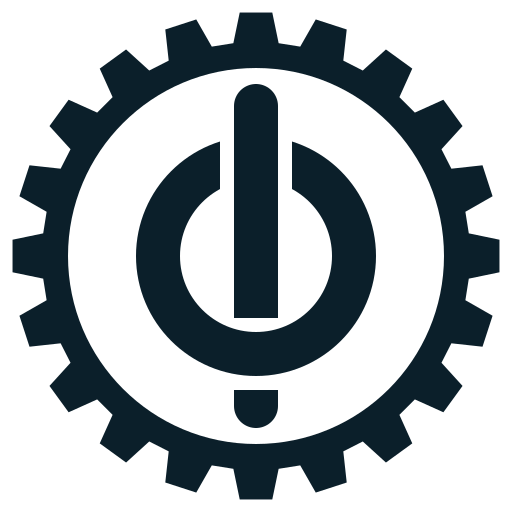

<picture>
  <source media="(prefers-color-scheme: dark)" srcset="assets/logo-dark.svg">
  
</picture>

# IOloom

### Electrical schematics and PLC programs in one project

_A sensor that you wire to an input becomes a variable in the program. Rename it in one place, and it changes in both._

  <a href="#overview"><b>Overview</b></a> |
  <a href="#scope"><b>Scope</b></a> |
  <a href="#formats"><b>Formats</b></a> |
  <a href="#foundation"><b>Foundation</b></a> |
  <a href="docs/roadmap.md"><b>Roadmap</b></a> |
  <a href="#documentation"><b>Docs</b></a>

---

> [!NOTE]
> **IOloom is in the planning stage, and it has no code yet.**
> [docs/research.md](docs/research.md) holds the facts and the risks.
> [docs/roadmap.md](docs/roadmap.md) says what comes next, and
> [docs/milestones.md](docs/milestones.md) holds every decision and the
> reason behind it.

---

## Overview

**IOloom** puts the electrical schematic and the PLC program of a machine in
one project.

A control system has two parts.
The schematic shows the wires, the sensors, and the PLC inputs and outputs.
The PLC program reads the inputs and sets the outputs.

Most free tools do only one of these parts.
QElectroTech draws schematics.
OpenPLC Editor writes and simulates PLC programs.
No free tool links the two.
The commercial tools link them only through a pair of products, such as EPLAN
and TIA Portal.

IOloom keeps one shared list of signals.
A signal is one PLC input or output, for example a sensor or a lamp.

<table>
<tr>
<td width="50%" valign="top">

### What it aims to do

- **Link the schematic and the program** through one signal list.
- **Rename in both directions**, with undo.
- **Cross-reference** a contact in a rung to its device on a sheet.
- **Run the program in the schematic**: click a push button, see the lamp.
- **Simulate a plant**, such as a tank or a conveyor, with no hardware.
- **Inject faults**: a broken wire, a stuck sensor, a tripped overload.

</td>
<td width="50%" valign="top">

### How it aims to behave

- The same app on macOS, on Windows, and on Linux.
- It works offline, on a laptop, with no PLC.
- It uses the IEC 61131-3 languages: LD, FBD, ST, IL, and SFC.
- It uses the IEC symbol library of QElectroTech.
- It reads and writes the common formats of both worlds.
- It checks the wiring against the program, and names each difference.

</td>
</tr>
</table>

---

## Scope

IOloom is for design and simulation on a laptop.
It does not connect to a real PLC.

Out of scope:

- Real PLC hardware and the download of programs to a device.
- Vendor protocols and the configuration of vendor modules.
- Drives and motion control.
- DWG files, manufacturer catalogs, and cabinet layout.

---

## Formats

| Format | Import | Export |
| :-- | :-: | :-: |
| QElectroTech element (`.elmt`) and project (`.qet`) | yes | `.qet` |
| PLCopen XML (TC6), for CODESYS, Machine Expert, TwinCAT, Beremiz | yes | yes |
| Structured Text (`.st`) and OpenPLC Editor v3 projects | yes | `.st` |
| I/O list (CSV, XLSX) | yes | yes |
| PDF, SVG, PNG, DXF | DXF | yes |
| Reports: parts list, terminal plan, wire list, I/O cross-reference | | yes |

[docs/roadmap.md](docs/roadmap.md#formats) says which phase brings each format.

---

## Foundation

IOloom is a fork of
[OpenPLC Editor](https://github.com/Autonomy-Logic/openplc-editor)
version 4, by Autonomy Logic.
It reads the element files of
[QElectroTech](https://qelectrotech.org).
[docs/milestones.md](docs/milestones.md) says why IOloom is a fork and not a
new program.

---

## Documentation

- [docs/research.md](docs/research.md): the research and the risks.
- [docs/architecture.md](docs/architecture.md): the architecture and the data model.
- [docs/roadmap.md](docs/roadmap.md): the phases, the formats, and the platforms.
- [docs/milestones.md](docs/milestones.md): the decisions and the reason for each one.
- [docs/releasing.md](docs/releasing.md): the versions, the codenames, and the release steps.
- [CHANGELOG.md](CHANGELOG.md): each release.
- [CONTRIBUTING.md](CONTRIBUTING.md) and [AGENTS.md](AGENTS.md): the rules for the work.

---

## Licence

IOloom is GPL-3.0. See [LICENSE](LICENSE).
OpenPLC Editor is GPL-3.0.
The QElectroTech elements are free to use in a diagram. Outside a diagram,
they are under CC-BY 3.0, and IOloom gives the credit that it requires.
